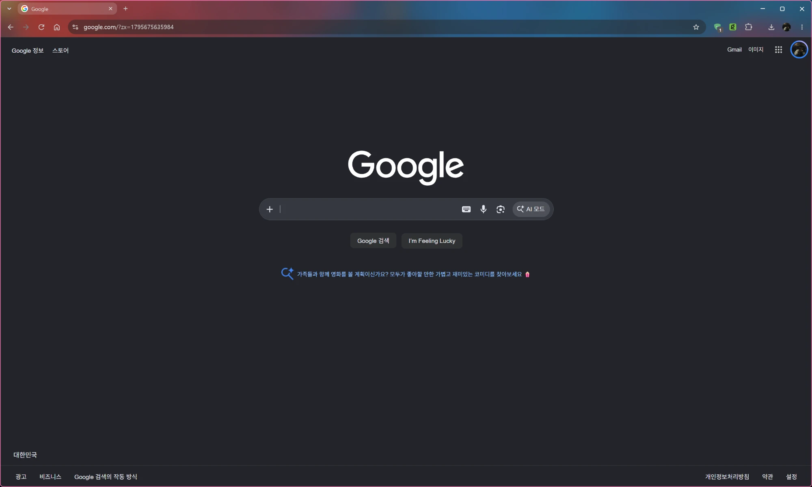
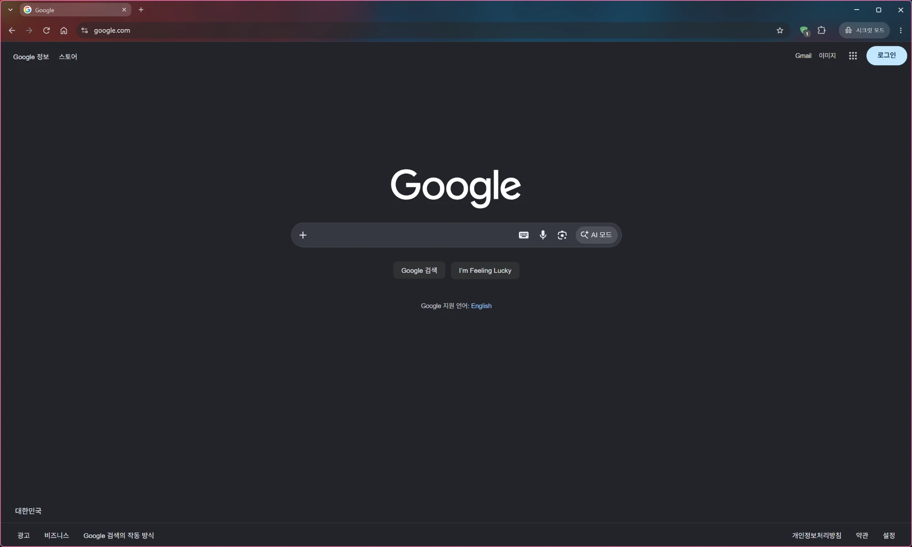

# Chrome Acrylic Titlebar

Lets the Windows 11 Acrylic effect show through the top of Google Chrome.
The tab strip and the toolbar become see-through and blurred, like the rest of
a Windows 11 style desktop, while web pages stay exactly as they are.

Incognito windows get a darker tint, so you can still tell them apart:

## Requirements

- Windows 11 22H2 or later, with **Transparency effects** turned on
  (Settings > Personalization > Colors).
- Google Chrome, 64-bit. Tested with Chrome 158.

## Getting started

To find the parts of Chrome it changes, the mod needs Chrome's debug symbols.
Windhawk downloads them from Google the first time, which takes a while.

1. Enable the mod and start Chrome. Chrome opens normally, without the
   effect, while the symbols download in the background (about 1.1 GB).
2. Wait a few minutes for the download to finish.
3. Fully exit Chrome, including any instance running in the background, and
   start it again. The effect is now applied.

Later starts apply the effect right away. After each Chrome update, the
symbols for the new version are downloaded once more, so repeat these steps.
Downloaded symbols are kept in `C:\ProgramData\Windhawk\Engine\Symbols`; you
can delete folders for old Chrome versions to free disk space.

## Settings

**Backdrop** (default: Acrylic)
The Windows effect shown behind the tab strip. Applies to windows opened after
the change.

- **Acrylic**: a strong blur of whatever is behind the window.
- **Mica Alt**: a darker, subtle tint taken from your wallpaper.
- **Mica**: a lighter, subtle tint taken from your wallpaper.

**Transparent inactive tabs** (default: on)
Tabs you're not viewing don't get a background of their own, so the effect
shows behind them too. The current tab and the tab under the mouse are still
highlighted. Applies to windows opened after the change.

**Transparent toolbar** (default: on)
Extends the effect to the row with the address bar and to the bookmarks bar.
Turn it off to keep that row solid. Applies right away.

**Translucent controls** (default: on)
Restyles the controls on top of the effect:

- the address bar becomes translucent, and its site info icon sits on it
  without a separate background;
- the current tab is shown as a soft, light rounded highlight;
- the lines between tabs and the divider next to your profile picture are
  hidden;
- the tab search and new tab buttons only show a background while you hover
  them;
- the "Incognito" label gets the same soft highlight as the current tab.

While you type in the address bar, it stays solid so it matches the list of
suggestions below it. Restart Chrome to apply.

**Incognito tint** (default: on)
Adds a dark tint behind the tab strip and toolbar of incognito windows.

**Hide duplicate Windows caption buttons** (default: on)
Once the tab strip is see-through, Windows' own minimize, maximize and close
buttons would show up behind Chrome's. This hides them. As a side effect, the
Alt+Space window menu may not open in Chrome windows.

**Download symbols from Google** (default: on)
Lets Windhawk download Chrome's symbols when they aren't on your PC yet. If you
turn it off, the mod only works with symbols that were already downloaded.
Restart Chrome to apply.

## Good to know

- When a Chrome window isn't focused, Windows shows the backdrop as a plain
  color. It returns when you click the window.
- The tint follows the Windows light or dark mode.
- If something looks wrong, disable the mod and restart Chrome to get the
  original look back.

## Credits

Hiding the duplicate caption buttons and loading symbols in the background are
adapted from [Brave Acrylic](https://windhawk.net/mods/brave-acrylic) by
bardelyne (MIT).
